# NAZAR architecture

## Pipeline

```mermaid
flowchart LR
  A[Device input<br/>Browser simulator · Webcam · Meta DAT Android] --> B[Consent gate<br/>mic/camera off by default<br/>separate upload opt-in]
  B --> C[Context<br/>visual focus + conversation memory]
  C --> D[Identify<br/>hotspot / manual scene<br/>optional server vision]
  D --> E[Retrieve<br/>curated bilingual KB<br/>concept lexicon + example overlap]
  E --> F{Live AI configured?}
  F -- no --> G[Curated answer<br/>QA pair + sources]
  F -- yes --> H[LLM grounded ONLY on retrieved facts]
  H --> I[Citation validation<br/>cited ids ⊆ retrieved ids]
  I -- fail / outage --> G
  I -- pass --> J[Live answer + sources]
  G --> K[Deliver<br/>TTS + captions + 3D camera/airflow]
  J --> K
```

## Components

| Layer | Where | Notes |
|---|---|---|
| Knowledge base | `packages/core/src/knowledge/*` | Typed TS data: entries, bilingual summaries, Q&A pairs, source ids, uncertainty notes, 3D hotspot metadata |
| Text processing | `packages/core/src/text.ts` | Arabic normalisation (diacritics, alef/taa/yaa variants), clitic stripping (و ف ب ل ك ال), language detection, wake-word stripping |
| Concept lexicon | `packages/core/src/lexicon.ts` | 28 concepts (cooling, materials, etiquette, unesco…) with English regexes and Arabic stems |
| Retrieval & answering | `packages/core/src/retrieval.ts` | Entity resolution (explicit > weak noun > what you're looking at > conversation), QA ranking, follow-ups (why/how/more), refusal rules |
| Conversation | `packages/core/src/conversation.ts` | Pure reducer: active entity, last answer, used answers, capped history |
| Web app | `apps/web` | React 18, Vite, R3F/drei, Tailwind, Framer Motion, Zustand; PWA manifest + service worker |
| Device adapters | `apps/web/src/lib/adapters.ts` | `BrowserSimulatorAdapter` (renders the 3D POV as a frame), `WebcamAdapter` (getUserMedia), Meta DAT info (native) |
| API | `apps/worker` | Hono + Zod on Cloudflare Workers. `/api/ask`, `/api/vision`, `/api/health`; CORS allow-list, rate limit, payload cap, timeouts |
| Native | `android/` | Kotlin, DAT 1.0.1 (`mwdat-core`, `mwdat-camera`, `mwdat-mockdevice`) |

## Entity resolution ("what does *it* mean?")

1. **Explicit mention.** If the visitor names an entry ("the dallah", "الجامع"), that entry is used.
2. **Weak noun.** A word like "tower" goes to the matching entry the visitor is looking at, if there is one. That is the barjeel in Al Fahidi, and the minarets at the mosque.
3. **Visual deixis.** "This" or "that" goes to the current focus (LOOK).
4. **Conversation.** Pronouns and bare follow-ups go to the active entry.

## Refusal rules

- If no topic concept matches and the question contains unknown words, NAZAR declines rather than guessing ("What's the weather?").
- If a topic is recognised but this entry has no verified answer for it, NAZAR says its sources don't cover it.
- If nothing is in view and nothing is named, NAZAR asks the visitor to look at a landmark first.

## Live AI guardrails (Worker)

- The prompt contains only the top retrieved facts, each with an ID. The model must return `usedFactIds`.
- An answer is rejected, and the curated answer used instead, if it cites an unknown ID, cites nothing, fails schema validation, times out after 8 seconds, or the provider errors.
- The vision prompt restricts output to catalogue IDs and forbids describing people. Confidence below 0.75 is marked *uncertain*, and the app only switches scenes automatically on *confident* results.

## Performance

- The 3D world is lazy-loaded. Geometry is procedural with no external assets, and textures are generated on a canvas at runtime.
- Repeated parts (merlons, airflow particles) use instanced meshes.
- Performance mode lowers the DPR and turns off shadows, sparkles, palm sway and some palms. It is on by default on mobile and on devices with 4 or fewer cores.
- Bundle sizes (gzip): app shell about 76 KB, three.js about 177 KB, R3F/drei about 100 KB, 3D world chunk about 6 KB, fonts bundled locally.
