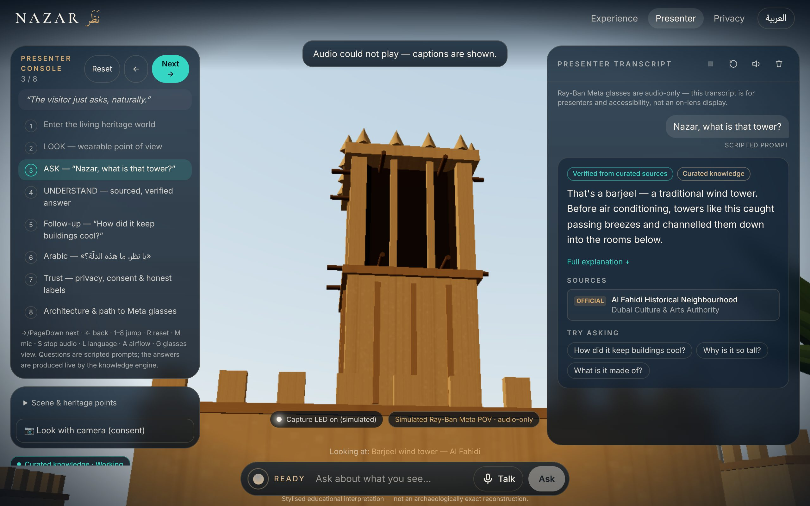
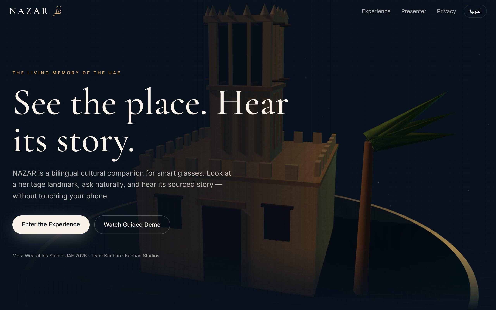
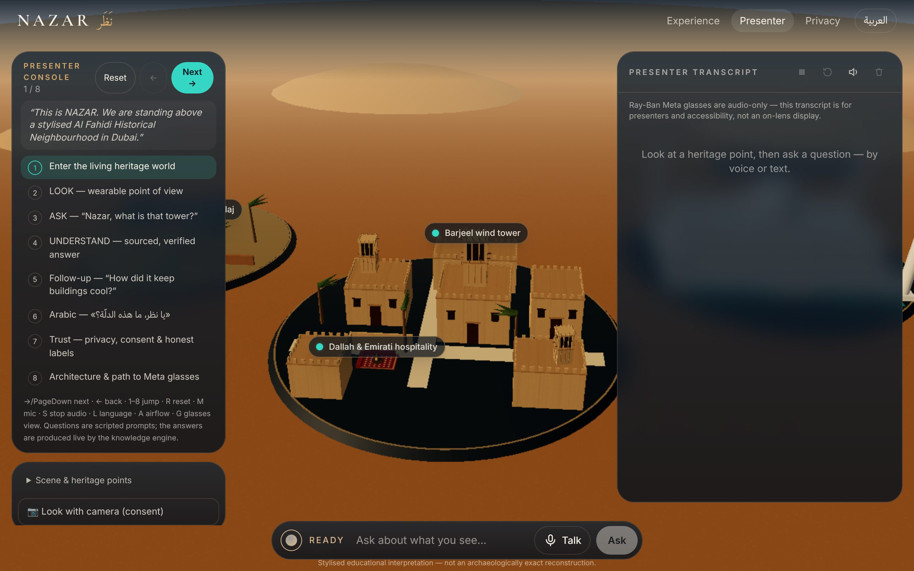
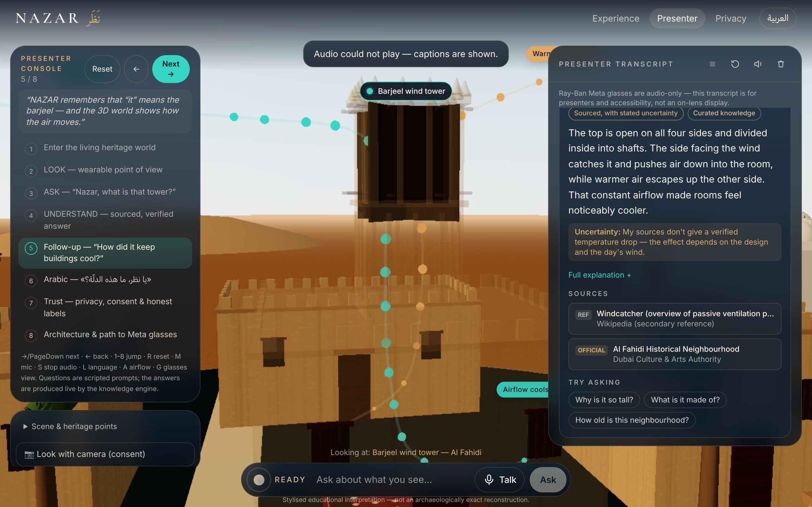
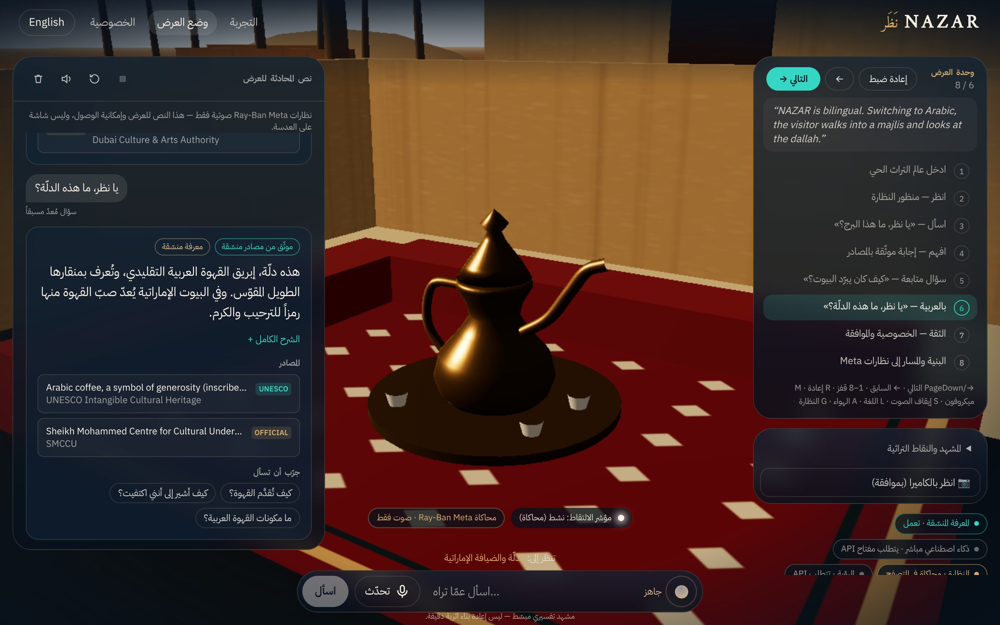
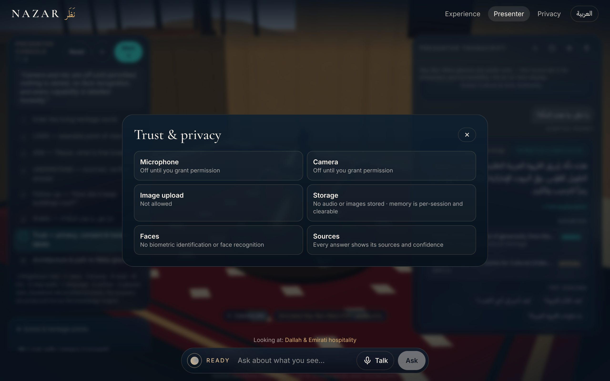
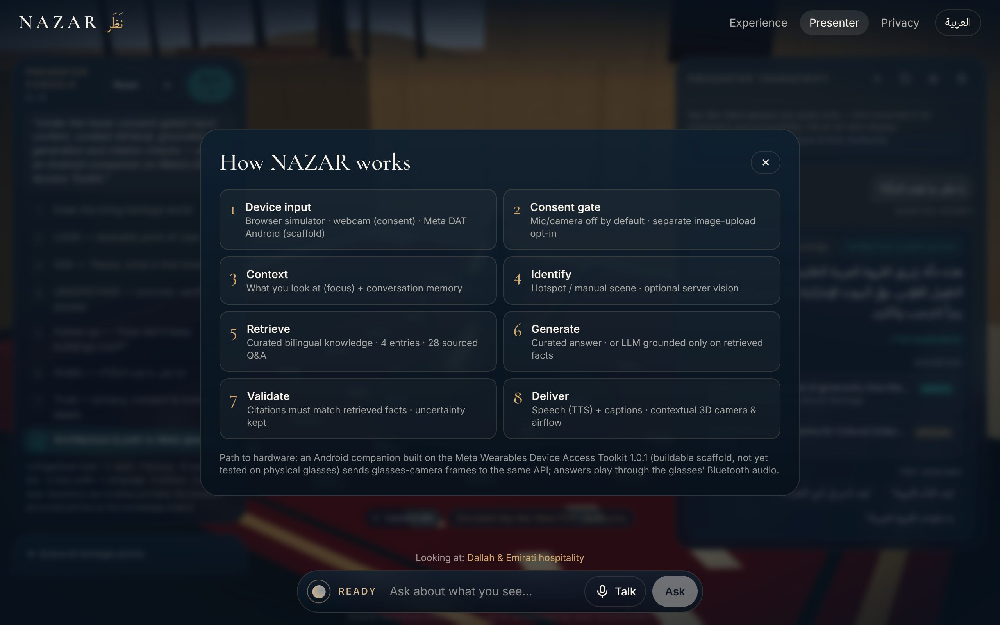
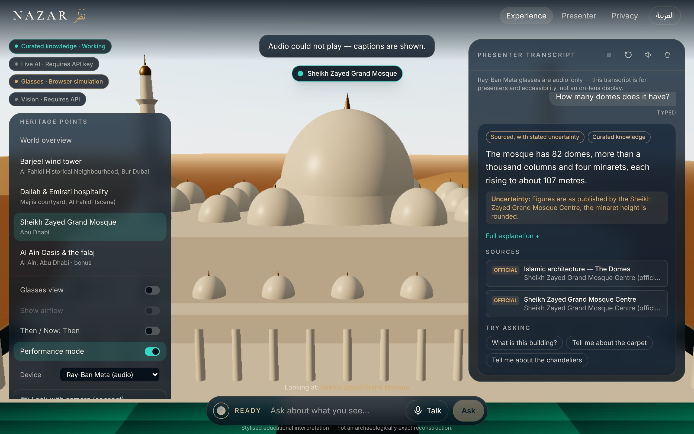
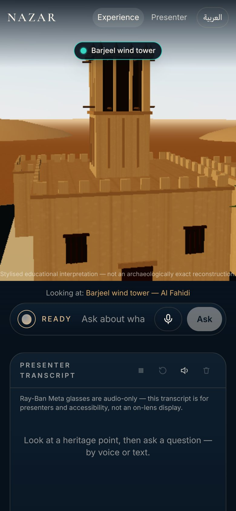

# NAZAR · نَظَر — The Living Memory of the UAE

**See the place. Hear its story.**

NAZAR is a wearable-first, bilingual cultural companion for UAE heritage. A visitor looks at a landmark, asks a question out loud, and hears a short answer with its sources, in English or Arabic. NAZAR remembers what "it" refers to across follow-up questions.

> **Meta Wearables Studio UAE 2026** · Virtual Pitchathon, 6 November 2026
> **Team Kanban** (Kanban Studios): **Awaiz Ahmed · Mohammad Umar · Bilal Feroz · Huda Mueen**

| | |
|---|---|
| **Live demo (GitHub Pages)** | https://4waiz.github.io/RAAWI/ — see [Deployment](#deployment) for status |
| **Presenter mode** | https://4waiz.github.io/RAAWI/pitch-demo |
| **Repository** | https://github.com/4waiz/RAAWI |



## What works today (honest status)

| Capability | Status | Notes |
|---|---|---|
| Interactive 3D world (Al Fahidi, majlis, Sheikh Zayed Grand Mosque, Al Ain Oasis) | **Working** | Procedural Three.js / React Three Fiber scene. Includes a barjeel model, airflow cutaway, Then/Now view and a low-performance mode. It is a stylised interpretation, not an archaeologically exact reconstruction. |
| Look → Ask → Listen conversation | **Working** | Voice input uses the browser Web Speech API where supported, with a text fallback. Spoken answers use browser speech synthesis, with captions shown alongside. |
| Curated, source-backed knowledge | **Working** | 4 heritage entries and 28 bilingual Q&A pairs. Every answer cites its sources and states uncertainty, and NAZAR declines rather than guesses. |
| Contextual follow-ups ("it", "why?", "tell me more") | **Working** | Conversation memory is kept per session and can be cleared. |
| English and Arabic (RTL) | **Working** | Arabic text is normalised for matching and shaped correctly; the layout switches to RTL. Arabic voice output depends on the Arabic voices installed on the device. |
| Presenter mode `/pitch-demo` | **Working** | 8 steps with keyboard and clicker support. Reset works without reloading the page. |
| Wearable point of view | **Simulated** | A browser simulation of audio-only Ray-Ban Meta glasses. No HUD is drawn for displayless glasses. |
| Live grounded AI answers (Gemini / OpenAI) | **Requires API key** | A Cloudflare Worker in `apps/worker` validates citations and falls back to curated answers. It is not deployed on GitHub Pages. |
| Camera capture | **Working** (consent-gated) | Recognition needs the Worker plus a provider key. Until then, choose the scene manually. |
| Meta Wearables Device Access Toolkit app | **Scaffold** | `android/` is written against DAT 1.0.1 and the Mock Device Kit. It has not been compiled or run on hardware yet; see [META_INTEGRATION.md](META_INTEGRATION.md). |
| Web App for Meta Ray-Ban Display | **Planned** | Applies to display-capable glasses only. |

## Quick start

```bash
pnpm install
```

```bash
pnpm dev            # http://localhost:5173 (curated mode, no keys needed)
```

```bash
pnpm test && pnpm typecheck && pnpm lint && pnpm build
```

```bash
pnpm --filter @nazar/web exec playwright test   # E2E + accessibility + mobile
```

Optional live AI:

```bash
cd apps/worker && cp .dev.vars.example .dev.vars   # add GEMINI_API_KEY or OPENAI_API_KEY
```

```bash
pnpm dev:api        # Worker on http://localhost:8787
```

```bash
VITE_NAZAR_API_URL=http://localhost:8787 pnpm dev
```

## Repository layout

```
packages/core   Knowledge base (EN/AR), retrieval engine, conversation memory — shared by web + API
apps/web        React + Vite + Three.js/R3F + Tailwind + Framer Motion + Zustand (PWA)
apps/worker     Cloudflare Worker (Hono + Zod): /api/health, /api/ask, /api/vision
android         Meta DAT 1.0.1 companion scaffold (Kotlin) + Mock Device Kit
docs            Screenshots
```

## Deployment

**GitHub Pages:** `.github/workflows/pages.yml` runs typecheck, lint, unit tests, the build, a secret-leak scan and the Playwright E2E/a11y/mobile tests. It then deploys `apps/web/dist` to GitHub Pages.

If Pages is not yet enabled on the repository, the workflow tries to enable it. If the token isn't allowed to do that, a repository admin needs to set **Settings → Pages → Build and deployment → Source: GitHub Actions** once and re-run the workflow.

Deep links such as `/pitch-demo` work because the build ships a `404.html` copy of the app.

**API (optional):** `apps/worker` deploys with `wrangler deploy`, or with the manual `api.yml` workflow, which needs `CLOUDFLARE_API_TOKEN` and `CLOUDFLARE_ACCOUNT_ID` secrets. Provider keys are set with `wrangler secret put GEMINI_API_KEY`. After deploying, rebuild the site with `VITE_NAZAR_API_URL` set to the Worker URL.

## Documentation

- [ARCHITECTURE.md](ARCHITECTURE.md): system design and diagrams
- [META_INTEGRATION.md](META_INTEGRATION.md): device capabilities, what is actually integrated, and remaining work
- [HERITAGE_SOURCES.md](HERITAGE_SOURCES.md): sources and verification status
- [DEMO_SCRIPT.md](DEMO_SCRIPT.md): the 60–90 second pitch demo, word for word
- [JUDGE_QA.md](JUDGE_QA.md): likely judge questions, with honest answers
- [PITCH_FACTS.md](PITCH_FACTS.md): claims we can make, and claims we must not
- [SECURITY.md](SECURITY.md): permissions, data handling and threat model

## Screenshots (real, captured from the running app)

| | |
|---|---|
|  |  |
|  |  |
|  |  |
|  |  |

The screenshots were taken in headless Chromium, which has no speech voices. That is why the "Audio could not play — captions are shown" notice appears in them.

---

NAZAR is an independent prototype by Team Kanban. It is not affiliated with or endorsed by Meta or any UAE government entity.
